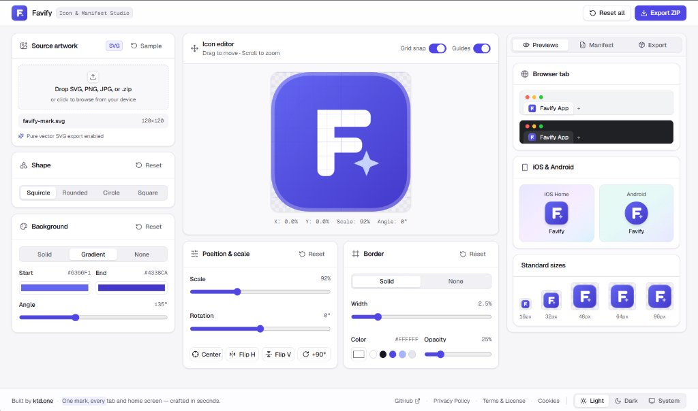

<div align="center">
  
  <h1>Favify</h1>
  <p><strong>One mark, every tab and home screen — crafted in seconds.</strong></p>
  <p>
    100% client-side, open-source, and always free · Built by <a href="https://ktd.one"><strong>ktd.one</strong></a>
  </p>
  <p>
    <a href="https://github.com/onektd/favify"></a>
    <a href="https://ktd.one"></a>
    <a href="./LICENSE"></a>
    
  </p>
</div>

---

## Overview

**Favify** ([github.com/onektd/favify](https://github.com/onektd/favify)) is a fast, static-exportable web application for crafting polished app icons, website favicons, iOS/Android mobile icons, and PWA manifests (`site.webmanifest`) in seconds.

Upload any **SVG**, **PNG**, **JPG**, or **WebP** artwork (or re-import a previously exported `favify-icons.zip`), position and style it on an interactive canvas with 5% grid snapping, and export a ready-to-drop `/assets/` bundle along with **Next.js App Router `Metadata`** and **HTML `<head>`** code snippets.

### Studio Preview

<div align="center">
  
</div>

---

## Key Features

- **Interactive Canvas Editor**: Drag to reposition, scroll to zoom, toggle **5% Grid Snap** and safe-zone crosshairs, or click any coordinate (`X`, `Y`, `Scale`, `Angle`) to type an exact value.
- **Silhouettes & Styling**:
  - Presets for **Squircle** (Apple-style continuous superellipse), **Rounded** (with custom corner radius), **Circle**, and **Square**.
  - **Solid**, **Linear Gradient** (custom start/end colors + angle), or **Transparent** backgrounds.
  - **Customizable Inner Border** (`Solid` or `None`) with adjustable width, color swatches, and opacity.
  - Quick transform actions: **Center**, **Flip H**, **Flip V**, and **+90°** rotation.
- **Pure Vector SVG & Multi-Size ICO Engine**:
  - Uploading an `.svg` exports a **pure vector `favicon.svg`** with vector clip paths, gradients, and borders.
  - Generates a genuine multi-resolution **`favicon.ico`** (`16×16`, `32×32`, `48×48`) directly in the browser.
- **Drop-In `/assets/` Bundle & Code Generator**:
  - Exports an organized `favify-icons.zip` containing `/assets/`, Xcode `ios/AppIcon.appiconset/`, Android `mipmap-*` folders, `nextjs-metadata.ts`, and `head-snippet.html`.
- **Round-Trip Project Editing (`favify.json`)**:
  - Every exported `.zip` includes `favify.json` and your original unclipped source artwork in `source/`. Drop the `.zip` back into Favify anytime to resume editing.
- **100% Client-Side Privacy**:
  - All image rendering and ZIP packaging happen locally in your browser. Your files are never uploaded to any server.

---

## Exported ZIP Structure

```text
favify-icons.zip
├── assets/
│   ├── favicon.ico               # Multi-size (16x16, 32x32, 48x48)
│   ├── favicon.svg               # Pure vector SVG (or clipped high-res raster)
│   ├── favicon-16x16.png
│   ├── favicon-32x32.png
│   ├── favicon-48x48.png
│   ├── apple-touch-icon.png      # 180x180
│   ├── icon-192x192.png          # PWA standard
│   ├── icon-512x512.png          # PWA high-res
│   ├── icon-maskable-192x192.png # PWA maskable
│   ├── icon-maskable-512x512.png # PWA maskable
│   └── site.webmanifest          # Pre-configured with /assets/... paths
├── ios/
│   └── AppIcon.appiconset/       # Xcode Contents.json + 12 iOS icon sizes (40px–1024px)
├── android/
│   ├── playstore-icon.png        # 512x512
│   └── mipmap-mdpi..xxxhdpi/     # ic_launcher.png (48px–192px)
├── nextjs-metadata.ts            # Ready-to-paste Next.js App Router Metadata & Viewport
├── head-snippet.html             # Ready-to-paste HTML <head> tags
├── favify.json                   # Project settings for re-importing into Favify
└── source/                       # Original unclipped source artwork
```

---

## Getting Started

### Prerequisites
- **Node.js** `v20+` (or `v22+`) and **npm**

### Local Development

```bash
git clone https://github.com/onektd/favify.git
cd favify
npm install
npm run dev
```

Open [http://localhost:3000](http://localhost:3000) in your browser.

### Testing & Static Build

```bash
# Run unit tests (Vitest)
npm test

# Type-check with TypeScript
npx tsc --noEmit

# Build static export into ./out
npm run build
```

---

## Deployment (GitHub Pages & Vercel)

Favify is configured with `output: 'export'` in [`next.config.ts`](next.config.ts) so it compiles to a 100% static `out/` directory:

- **Vercel**: Import `https://github.com/onektd/favify` in Vercel and deploy with zero configuration.
- **GitHub Pages**: Push to `main` — the included [`.github/workflows/deploy.yml`](.github/workflows/deploy.yml) workflow automatically builds and deploys `./out` to GitHub Pages.

---

## Contributing

Contributions, bug reports, and feature ideas are welcome! Please read [CONTRIBUTING.md](./CONTRIBUTING.md) before opening a pull request.

---

## License & Attribution

Favify is open-source and **always free for everyone** under the **[MIT + Commons Clause License](./LICENSE)**, created by **[ktd.one](https://ktd.one)** ([github.com/onektd/favify](https://github.com/onektd/favify)).

- **Free to use, fork, modify, and self-host.**
- **Commercial resale prohibited**: Forking, renaming, or packaging Favify to sell or offer as a paid/commercial tool is strictly prohibited.
- **Attribution required**: All copies and forks must retain attribution to **[ktd.one](https://ktd.one)** and **[github.com/onektd/favify](https://github.com/onektd/favify)**.
- **Your generated icons belong to you**: Icons and manifests exported from Favify are 100% yours to use in any personal or commercial project.
